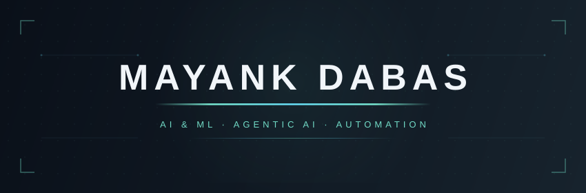
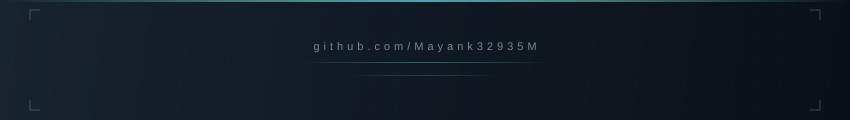

<!-- ═══════════════════════════════════════════════════════════════════ -->
<!--                        HERO BANNER                                -->
<!-- ═══════════════════════════════════════════════════════════════════ -->

  &nbsp;
  &nbsp;
  

  

<!-- ═══════════════════════════════════════════════════════════════════ -->
<!--                        ABOUT ME                                   -->
<!-- ═══════════════════════════════════════════════════════════════════ -->

  

> I'm a first-year dual-degree (B.Tech + M.Tech) AI & ML student at **USAR, GGSIPU**, based in Delhi. I build with LLMs, automate everything I can, and learn by shipping.

- 🤖&ensp;Agentic AI: ReAct loops, orchestrator/subagent setups, Claude & Gemini APIs
- ⚙️&ensp;Automation pipelines (n8n) and Python backends that connect AI to real data
- 🎬&ensp;AI video + editing workflows (DaVinci Resolve, CapCut, Kling, Higgsfield)
- 🌐&ensp;Freelance web + video work for local businesses and Instagram pages
- 📚&ensp;Used to work with **Kalyan Classes**, creating and teaching CBSE English curriculum for Class 6–10
- 🧩&ensp;Grinding LeetCode in Python to build the fundamentals properly

  

<!-- ═══════════════════════════════════════════════════════════════════ -->
<!--                        TECH STACK                                 -->
<!-- ═══════════════════════════════════════════════════════════════════ -->

  

<table>
  <tr>
    <td valign="middle" width="200"><h3>Languages</h3></td>
    <td valign="middle">
      
      
      
      
    </td>
  </tr>
  <tr>
    <td valign="middle"><h3>Currently Learning</h3></td>
    <td valign="middle">
      
      
      
      
      
    </td>
  </tr>
  <tr>
    <td valign="middle"><h3>Frontend & Desktop</h3></td>
    <td valign="middle">
      
      
      
    </td>
  </tr>
  <tr>
    <td valign="middle"><h3>AI & Backend</h3></td>
    <td valign="middle">
      
      
      
      
      
    </td>
  </tr>
  <tr>
    <td valign="middle"><h3>Cloud & Deploy</h3></td>
    <td valign="middle">
      
      
    </td>
  </tr>
  <tr>
    <td valign="middle"><h3>Tools & Workflow</h3></td>
    <td valign="middle">
      
      
      
      
      
      
      
    </td>
  </tr>
  <tr>
    <td valign="middle"><h3>Familiar With (basics)</h3></td>
    <td valign="middle">
      
      
    </td>
  </tr>
  <tr>
    <td valign="middle"><h3>Creative</h3></td>
    <td valign="middle">
      
      
      
    </td>
  </tr>
</table>

  

<!-- ═══════════════════════════════════════════════════════════════════ -->
<!--                        PROJECTS                                   -->
<!-- ═══════════════════════════════════════════════════════════════════ -->

  

<table>
  <tr>
    <th width="180" align="left">Project</th>
    <th align="left">What it is</th>
    <th width="80" align="center">Repo</th>
  </tr>
  <tr>
    <td><b>FORENSIC-X</b></td>
    <td>AI-assisted digital forensics framework (SUTRAM 2026)</td>
    <td align="center"></td>
  </tr>
  <tr>
    <td><b>Suraksha Sense</b></td>
    <td>AI powered Finance recommendation</td>
    <td align="center"></td>
  </tr>
  <tr>
    <td><b>Null Game</b></td>
    <td>Game, in development</td>
    <td align="center"></td>
  </tr>
</table>

<table>
  <tr>
    <th width="180" align="left">Project</th>
    <th align="left">My role</th>
    <th width="80" align="center">Repo</th>
  </tr>
  <tr>
    <td><b>Stivium</b></td>
    <td>Building an IDE from scratch in Rust + Tauri with Aditya Bhatnagar. With frontend Using Typescript and Tailwind CSS. Actively in development.</td>
    <td align="center"></td>
  </tr>
  <tr>
    <td><b>REDZONE</b> (SIH 2026)</td>
    <td>Frontend design, impact strategy, and pitching to the judges. Disaster relocation decision-support tool for Assam flood/erosion scenarios.</td>
    <td align="center"></td>
  </tr>
  <tr>
    <td><b>Eventtwin</b></td>
    <td>UI selection and impact strategy (non-code role). <i>add one-liner</i></td>
    <td align="center"></td>
  </tr>
  <tr>
    <td><b>VeriVision Integrity Assurance</b></td>
    <td>Team member (support role). <i>add one-liner</i></td>
    <td align="center"></td>
  </tr>
</table>

  

<!-- ═══════════════════════════════════════════════════════════════════ -->
<!--                        FOOTER                                     -->
<!-- ═══════════════════════════════════════════════════════════════════ -->

<b>📬 Open to collabs, freelance work, and interesting AI problems</b>

  &nbsp;
  &nbsp;
  

